# Arquitectura del Sistema de 5 Capas: Sentix-Hotel

**Proyecto:** Sentix-Hotel (Plataforma Inteligente de Análisis de Sentimiento y Minería de Opinión en Reseñas de Hospedaje en Español)  
**Materia:** Tópicos y Programación Avanzada  

---

## Diagrama de Flujo y Relación entre las 5 Capas

```mermaid
flowchart TD
    subgraph CAPA1["1. Capa de Datos y EDA"]
        D1["Dataset Crudo: Reseñas de Hoteles en Español"] --> D2["Análisis Exploratorio (EDA): Distribución de clases y longitudes"]
        D2 --> D3["Split Estratificado Train/Test (Semilla fija: 42)"]
    end

    subgraph CAPA2["2. Capa de Pipeline de NLP"]
        NLP1["Normalización: Minúsculas, tildes, signos, URLs, emojis"] --> NLP2["Tokenización: Segmentación léxica del dominio"]
        NLP2 --> NLP3["Stop Words: Filtro en español (Conservando 'no', 'nunca', 'sin')"]
        NLP3 --> NLP4["Reducción Morfológica: Comparativa Stemming (NLTK) vs Lematización (spaCy)"]
        NLP4 --> NLP5["Vectorización TF-IDF: Comparativa Unigramas vs Unigramas + Bigramas"]
    end

    subgraph CAPA3["3. Capa de Modelado y Evaluación"]
        M1["Modelo 1: Regresión Logística (Interpretable / Coeficientes)"]
        M2["Modelo 2: Random Forest / XGBoost (Ensamble No Lineal)"]
        CV["Validación Cruzada y Ajuste de Hiperparámetros (GridSearchCV)"]
        EVAL["Evaluación: F1-score, Precision, Recall, Matriz de Confusión"]
        SER["Serialización: Exportación de Pipeline y Modelo (.joblib)"]
        
        M1 --> CV
        M2 --> CV
        CV --> EVAL
        EVAL --> SER
    end

    subgraph CAPA4["4. Capa de Backend (API REST - FastAPI)"]
        API1["Carga de Artefactos Serializados (.joblib)"]
        API2["Validaciones de Entrada (Pydantic: no vacío, límites)"]
        API3["Endpoints REST: /predict, /nlp-steps, /metrics, /health"]
        
        API1 --> API2 --> API3
    end

    subgraph CAPA5["5. Capa de Frontend (Interfaz Web)"]
        UI1["Entrada de Reseña (Individual o Lote CSV)"]
        UI2["Visualizador Paso a Paso del Pipeline de NLP"]
        UI3["Indicador de Sentimiento y Probabilidad (%)"]
        UI4["Dashboard de Métricas y Comparativa de Modelos"]
        
        UI1 --> UI2
        UI2 --> UI3
        UI3 --> UI4
    end

    D3 -->|"Datos de Entrenamiento"| NLP1
    NLP5 -->|"Matriz TF-IDF"| M1
    NLP5 -->|"Matriz TF-IDF"| M2
    SER -->|"pipeline_nlp.joblib y model.joblib"| API1
    API3 <-->|"HTTP JSON (fetch asíncrono)"| UI1
```

---

## Descripción Técnica de las Capas

1. **Capa 1 (Datos y EDA):** Asegura la integridad del dataset en español, documenta valores faltantes, balance de clases y genera particiones estratificadas donde el test set queda completamente aislado.
2. **Capa 2 (Pipeline de NLP):** Aplica la secuencia obligatoria de procesamiento. Conserva términos críticos de negación y ofrece comparativas directas entre Stemming y Lematización, así como entre Unigramas y Bigramas.
3. **Capa 3 (Modelado ML):** Entrena y optimiza dos familias de modelos (lineal vs ensamble no lineal), genera matrices de confusión y empaqueta el pipeline en un único artefacto serializado `.joblib`.
4. **Capa 4 (Backend API REST):** Expone endpoints tipados y validados con Pydantic en FastAPI, consumiendo el pipeline serializado sin reimplementar código de limpieza.
5. **Capa 5 (Frontend Web):** Interfaz reactiva desacoplada que permite al usuario interactuar, ver la transformación del texto en tiempo real y analizar el desempeño técnico de los modelos.
